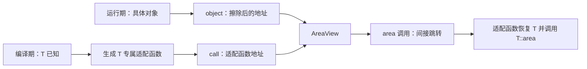

# 实现原理与源码阅读

[学习入口](README.md) · [讲义](lesson.md)

固定源码为 [ngcpp/proxy 4.1.0](https://github.com/ngcpp/proxy/tree/1c7ca609aba6d73df06183c14db9d2d210399af3)，不是微软旧 main。以下符号和行号已按该提交核查；后续版本需重新定位。

## 1. 先手写一个最小类型擦除模型

完整程序是 [04-erasure-model.cpp](examples/04-erasure-model.cpp)。它只借用对象、只支持 `const area()`；核心可以理解为：

```cpp
const void* object;
double (*call)(const void*) noexcept;
```

模板构造函数看到具体 `T`，生成一个适配函数，其内部把 `const void*` 转回 `const T*` 再调用 `area()`。包装存储对象地址和此适配函数的地址。之后消费者只看到固定的 `AreaView` 类型。



这里没有运行时查类型名字，也无需调用 `dynamic_cast`。类型安全依赖构造时绑定“地址与正确适配函数”的不变量。模板负责生成不同 T 的适配代码，函数指针负责在运行时选择它。

模型可以帮助理解所有类型擦除，但不是 Proxy 的布局复刻：它没有拥有型 P、通用 conventions、多重 overload、生命周期分派、元数据组合或布局约束。删掉临时对象构造只能阻止一类悬垂，无法证明所有借用都有效。

## 2. 官方库擦除的是 P，不只是 T*

Proxy 要处理 `T*`、`unique_ptr<T>`、`shared_ptr<T>`、内联拥有型句柄等，因此存储区容纳 P，自定义分派适配函数知道如何恢复 P。普通操作再对它解引用得到目标。

概念布局（不是固定 ABI）：

```text
proxy<F>
├── meta_：能力/生命周期的分派元数据，或到元数据的指针
└── ptr_：对齐的存储区，在其中构造具体 P
                 ├── P = T* / unique_ptr<T> / shared_ptr<T> → 外部对象
                 └── P = inplace_ptr<T>                  → 内部包含 T
```

[`core.h` 的 `proxy` 类](https://github.com/ngcpp/proxy/blob/4.1.0/include/proxy/v4/detail/core.h#L922)最终保存 `meta_` 与 `ptr_`（1233–1234 行）。默认 builder 的 P 存储预算为两倍指针大小，**整个 proxy 大小不等于这个预算**；还有元数据与对齐。

## 3. 构造主路径：make_proxy 到 initialize

以下沿示例 `make_proxy<Shape, Square>(5.0)`，区分类型选择与对象构造。

1. `facade_builder::build` 在编译期形成 facade 描述。`add_convention` 等步骤操作类型集合，不创建动态接口对象。
2. [`proxy_creation.h` 的 `make_proxy_impl`](https://github.com/ngcpp/proxy/blob/4.1.0/include/proxy/v4/detail/proxy_creation.h#L292)以 `if constexpr (proxiable<inplace_ptr<T>, F>)` 选择存储策略。可接入则构造内联句柄；否则进入 `allocate_proxy_impl`，按分配型句柄的约束进一步选择实现。
3. `proxy` 构造函数调用 `initialize<P>`，在 `ptr_` 上 `std::construct_at` 构造 P，并设置对应 P 的元数据。步骤的代码由模板生成，真正的对象构造发生在运行时。
4. 若 P 不满足布局、生命周期或 convention，编译期诊断在接入处发生；不是运行时试错后转去任意替代接口。

原始 P 是 `shared_ptr<T>` 时，直接把它传入 `proxy`，不经过 `make_proxy` 的内联选择。**工厂构造和已有指针接入是不同入口，不能把所有构造都解释成“小对象优化”。**

源码线索：[facade_creation.h 的 builder 默认值](https://github.com/ngcpp/proxy/blob/4.1.0/include/proxy/v4/detail/facade_creation.h#L175)、[`initialize<P>`](https://github.com/ngcpp/proxy/blob/4.1.0/include/proxy/v4/detail/core.h#L1201)。

## 4. 调用主路径：p->area()

以默认 indirect convention 为例：

```text
p->area()
  → proxy::operator-> 返回间接访问器
  → 宏生成的 accessor::area
  → ADL invoke<MemArea, double() const noexcept>(accessor)
  → detail::invoke_impl 取得相应 conv_meta 的 invoke 函数指针
  → 进入为 P 生成的适配函数
  → reinterpret_invoke<P, MemArea, double>
  → get_operand 恢复 P，对 indirect convention 计算 *P
  → MemArea 的表达式分派：目标.area()
```

`operator->()` 暴露的是访问器，而不是未知具体类型的 `T*`。`*p` 也不是把被擦除类型恢复给业务调用者；它是用于间接能力的访问入口。

编译期已知的内容：F、P、dispatch、overload、访问器形状及具体适配函数体。运行时保存的内容：某个 P 的实例和选择其分派适配函数所需的元数据。调用方不了解 P，适配函数的实例化代码了解 P。

若是 direct convention，`get_operand` 返回 P，省去对 P 的解引用；后续执行的是句柄表达式。4.1 中 `reinterpret_invoke` 还暴露为优化接口；它要求调用方正确知道存储的具体 P，不是任意强转后仍有动态类型检查的安全入口。

查阅：[宏访问器生成](https://github.com/ngcpp/proxy/blob/4.1.0/include/proxy/v4/proxy_macros.h#L84)、[`conv_meta` 为 P 生成函数地址](https://github.com/ngcpp/proxy/blob/4.1.0/include/proxy/v4/detail/core.h#L351)、[`invoke_impl`、`get_operand` 与 `reinterpret_invoke`](https://github.com/ngcpp/proxy/blob/4.1.0/include/proxy/v4/detail/core.h#L799)。

## 5. 生命周期也被类型擦除

调用者不知道 P，销毁时如何正确释放？答案仍是保存与 P 匹配的分派代码。`facade_traits::meta` 把调用元数据和所需的 copy/relocate/destroy 元数据组合起来。

- 销毁 P 为裸指针时，不销毁目标对象；P 为 unique_ptr 时，由其析构释放目标。
- 复制包装时调用 P 的复制设施；于是复制裸指针、shared_ptr 和库自己的值拥有型句柄产生不同语义。
- relocation 是库定义的约束与优化维度。符合库 trait 的类型可通过字节迁移转移所有权并清除原存储状态，其他路径可能执行 move/destroy；不能把这种性质理解为“所有 C++ 类型都能 memcpy 后各析构一次”。

默认 facade 的复制级别是 none、relocation 是 trivial、析构是 nothrow。库对部分智能指针提供自己的 bitwise relocation trait 支持；这里的“trivial”不应直接等同于 `std::is_trivially_move_constructible`。自定义 P 若接入失败，需要逐项核查，不只看目标对象有没有 area 方法。

查阅：[`copy_dispatch` / `relocate_dispatch` / `destroy_dispatch`](https://github.com/ngcpp/proxy/blob/4.1.0/include/proxy/v4/detail/core.h#L489)、[`facade_traits` 元数据组合](https://github.com/ngcpp/proxy/blob/4.1.0/include/proxy/v4/detail/core.h#L686)、[智能指针 relocation trait](https://github.com/ngcpp/proxy/blob/4.1.0/include/proxy/v4/detail/proxy_creation.h#L322)。

## 6. 与虚表的相似性和差别

两者都可以依靠函数地址做运行时间接分派。常见 virtual ABI 在目标对象中放 vptr，调用方通过对象找到虚表槽；Proxy 将适配元数据放在包装侧，实现对象不需要因此增加虚函数或继承关系。

也不能简单说“Proxy 永远是一个 vtable 指针”：4.1 的 `meta_ptr_traits` 会根据元数据大小、对齐和其他性质，选择把小元数据嵌入包装，或使用到静态元数据的指针。具体布局随 facade 和实现变化。

这为缓存行为、内联对象和间接加载次数带来优化机会，不是所有场景必胜的证明。编译器也可能对 virtual 去虚化，或对 Proxy 适配路径做内联折叠；应看实际构造/调用环境。

查阅：[`meta_ptr_indirect_impl` 与 `meta_ptr_direct_impl`](https://github.com/ngcpp/proxy/blob/4.1.0/include/proxy/v4/detail/core.h#L733)。

## 7. 建议的源码阅读顺序

| 顺序 | 文件/符号 | 需要回答的问题 |
| --- | --- | --- |
| 1 | `detail/facade_creation.h`：`basic_facade_builder`、`build` | 一个 facade 记录什么？默认约束是什么？ |
| 2 | `detail/proxy_creation.h`：`make_proxy_impl`、`allocate_proxy_impl` | 内联选择检查的是 T 还是包装 P？ |
| 3 | `detail/core.h`：`proxy`、`initialize` | P 在哪里构造，元数据如何绑定？ |
| 4 | `proxy_macros.h`：`PRO4D_DEF_MEM_ACCESSOR` | `area` 这个名字如何到达 invoke？ |
| 5 | `detail/core.h`：`conv_meta`、`invoke_impl`、`get_operand` | 哪一步读函数指针，哪一步恢复 P？ |
| 6 | `detail/core.h`：`facade_traits`、生命周期 dispatch、`meta_ptr_traits` | 复制/销毁和元数据优化如何组合？ |
| 7 | `detail/skills.h` | view/weak 等能力如何扩展基础设施？先按需求读 |

本地搜索（先按[示例说明](examples/README.md)取得源码）：

```bash
rg -n 'make_proxy_impl|allocate_proxy_impl' /private/tmp/learning-proxy-4.1.0/include/proxy/v4/detail/proxy_creation.h
rg -n 'initialize|conv_meta|invoke_impl|get_operand|meta_ptr_traits|copy_dispatch|destroy_dispatch' /private/tmp/learning-proxy-4.1.0/include/proxy/v4/detail/core.h
rg -n 'PRO4D_DEF_MEM_ACCESSOR' /private/tmp/learning-proxy-4.1.0/include/proxy/v4/proxy_macros.h
```

验收不要求记住模板层级：能从一个具体调用解释“编译期生成什么、运行时存什么、调用时读什么、最终谁负责销毁”即可。
