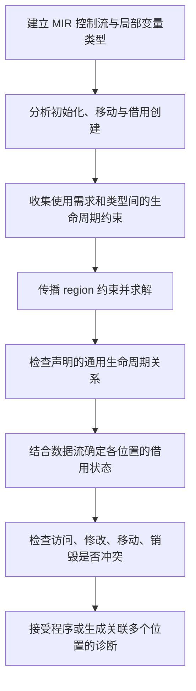

# 手工模拟：借用检查的检查点与检查内容

[学习入口](README.md) · [编译机制](compiler-mechanism.md) · [学习过程](learning-log.md)

本页回答“编译器如何识别检查点、每个检查点检查什么”。以普通共享字符串引用和直线控制流为主，模型对应 rustc 的 MIR 借用检查阶段，不是逐条复刻当前 rustc 的内部数据结构。下方 P 编号与 R 名称用于教学，未声称是 rustc 实际 dump 的编号。

若问题是“为什么返回 x 会生成 a: b，而不是反向”，先读[从 MIR 操作到生命周期约束](ir-to-constraints.md)：它展开本页所用类型约束的生成规则，并给出本机 MIR 与稳定版本源码入口。

## 1. 先看完整流程



重点：不是看到第一行就确定 'a 的结束位置。后续使用会通过约束传播影响前面的借用要求。

## 2. 哪些操作值得标成检查点

| 操作类别 | 例子 | 收集/检查内容 |
| --- | --- | --- |
| 创建数据/初始化 | let s = String::from(...) | 哪个 place 已初始化，谁持有值；此处 mut 不自动产生借用 |
| 创建借用 | &s、&mut s、调用 as_str | 借用的 place、共享或可变、借用开始位置、对应 region |
| 引用赋值/存字段 | r = x、View { text: x } | 提供方引用类型能否满足接收方类型；根据变型产生 outlives 关系 |
| 函数/方法调用 | f(x)、s.as_str() | 实参与形参匹配，返回类型与接收处匹配；可能存在隐式借用与重借用 |
| 返回 | return x 或尾表达式 x | 返回表达式能否满足函数声明的输出类型与生命周期要求 |
| 引用使用 | *r、r.len()、把 r 传给后续使用它的函数 | 对应 region 在哪些控制流位置必须有效；是否访问了冲突借用中的 place |
| 修改/移动/销毁 | push_str、move、drop、作用域末尾 | 当前借用状态下该操作是否允许；被借用数据失效时是否仍需保持借用 |
| 分支/循环汇合 | if、loop | 按控制流汇总数据流与有效性要求，不能仅找文本中的最后一行 |

同一条源码可能包含多个检查点。println 宏会展开，as_str 是方法调用；MIR 会把相应操作拆成更明确的语句和基本块。

## 3. 完整例子与位置编号

```rust
fn first<'a>(x: &'a str, _y: &'a str) -> &'a str {
    x
}

fn main() {
    let outside = String::from("outside");          // P1
    let r;
    {
        let inside = String::from("inside");        // P2
        r = first(outside.as_str(), inside.as_str()); // P3
    }                                                // P4: inside 销毁
    println!("{r}");                                // P5
}                                                    // P6: outside 销毁
```

这是已验证的 M02 B 外层打印例子，报 E0597。下面解释如何得到这个结论。

### 第一步：单独检查 first 实现

函数体检查时，'a 是签名声明的通用参数，不能为方便而假定它是一个特别短的局部范围。输入 x 的类型是 &'a str；返回类型也是 &'a str，尾表达式 x 满足返回要求。

_y 没有在函数体中读取也不取消其签名。first 的实现本身合法，出错的是 main 中的调用与后续使用组合。

对照：`fn wrong<'a, 'b>(x: &'a str) -> &'b str { x }` 的返回操作会要求 a 覆盖 b；签名未提供该关系，则实现检查失败，不能等某次调用碰巧合适才算通过。

### 第二步：记录 main 的数据与借用事实

先不判断最后结果，记录两类信息：

- 值/数据状态：outside 在 P1 初始化、P6 销毁；inside 在 P2 初始化、P4 销毁；r 在 P3 被赋值、P5 使用。
- 借用记录：P3 为两个 as_str 调用创建相应共享借用，经调用返回切片；底层依赖分别来自 outside 与 inside。

教学上把两份输入切片的 region 记为 Rx、Ry，本次调用中 'a 的实例记为 Rc，保存到 r 的引用 region 记为 Rr。实际 MIR 中可能有更多临时引用/重借用，这里省略中间节点，但保留约束方向。

### 第三步：只生成约束，暂不定结束位置

记 A: B 为 A 必须覆盖 B：

```text
P3，输入 x 匹配：Rx: Rc
P3，输入 y 匹配：Ry: Rc
P3，返回值赋给 r：Rc: Rr
P5，读取 r：P5 必须在 Rr 中
```

这里 Ry: Rc 来自形参 _y: &'a str，不来自函数体是否返回 _y。

### 第四步：传播使用需求

```text
P5 ∈ Rr
Rc: Rr  ⇒ P5 ∈ Rc
Rx: Rc  ⇒ P5 ∈ Rx
Ry: Rc  ⇒ P5 ∈ Ry
```

含义：外层的读取要求，经返回值和参数契约传播，使两份输入借用都必须支持到后续读取。不是在运行时实际沿两个输入读取，而是静态契约要求。

把 region 理解成控制流位置等元素的集合，概念算法可以写成：

```text
给每个 region 填入已知必须有效的位置
反复处理约束 A: B：Values[A] |= Values[B]
直到集合不再变化
```

这是固定点模型。rustc 会把 outlives 约束组织为图、合并强连通分量，再在形成的 DAG 上传播，以减少重复计算，不是必然按上面朴素循环执行。

### 第五步：检查失效和冲突位置

P4 是 inside 的销毁点。在 P3 创建、依赖 inside 的借用，根据前一步结果仍需要为 P5 的使用保持有效。P4 的销毁会使该借用失效，因此拒绝。

注意区分两件事：region 传播算出“哪些地方需要借用”；对实际数据的销毁/移动/修改检查，判断这些要求能否安全满足。不是所有局部失效错误都表现为 region 求解器解不出一个数值。

如果是 `let view = text.as_str(); text.push_str("!"); println!("{view}");`，同样先传播得知共享借用需要跨过修改，再在 push_str 获取可变借用/写入的位置检测冲突，报 E0502。

### 第六步：组织诊断

错误通常关联三个关键位置：

1. 借用在哪里产生：P3 的 inside.as_str()。
2. 什么操作使借用失效：P4 的 inside 销毁。
3. 为什么借用还需有效：P5 的 r 读取。

这也是阅读 E0597 时最有用的三个检查点。

## 4. 用同一流程解释修复

| 改动 | 哪条事实/约束改变 | 为什么结果改变 |
| --- | --- | --- |
| _y 改成 &str，输出仍为 &'a str | y 使用独立参数，不再要求 Ry: Rc | P5 的需求不再经输出传播到 inside 的借用 |
| 打印移到内层调用之后 | r 的读取不再位于 inside 销毁之后 | 两份输入借用可在数据仍有效时支持读取 |
| 只说“函数体返回 x” | 没改签名或调用处事实 | 不会删除 Ry: Rc，结果不变 |

## 5. 实际实现与教学模型的边界

- 这是对 ordinary shared references 的解释，涉及嵌套类型时须遵循变型规则。
- MIR 中还有临时值、重借用、分支、drop 路径等；源码一行不等于一个 MIR 点。
- 通用参数必须在声明关系下成立，不能像调用处待推断的 region 一样任意选择。
- 析构使用、两阶段借用、闭包等会增加处理细节，本页不把简化流程冒充完整 rustc 实现。

## 官方实现入口与资料

核查日期：2026-10-20。资料解释的是 rustc 当前公开实现路线，不声称已逐行核对本机 1.98.0 的源码。

- [MIR borrow check](https://rustc-dev-guide.rust-lang.org/borrow-check.html)：rustc_borrowck、mir_borrowck，整体阶段和最终访问检查。
- [Constraint propagation](https://rustc-dev-guide.rust-lang.org/borrow-check/region-inference/constraint-propagation.html)：liveness、outlives、region 集合、SCC 与传播。
- [Universal regions](https://rustc-dev-guide.rust-lang.org/borrow-check/region-inference/lifetime-parameters.html)：签名参数、已知关系、check_universal_regions。

本页未新增独立实验；所用 B 外层及修复版本已有编译证据，源码见 exercises/03-module-check/，原始回答与结果见学习记录。
